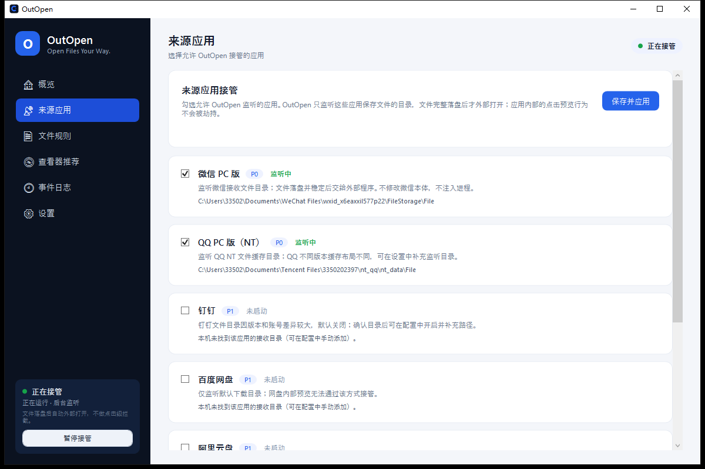
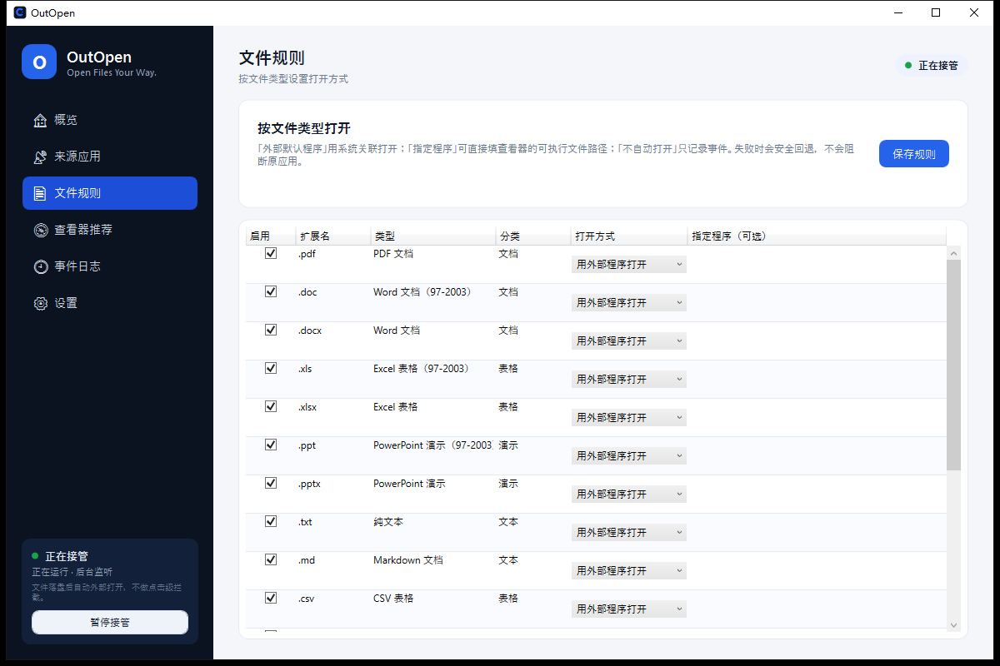
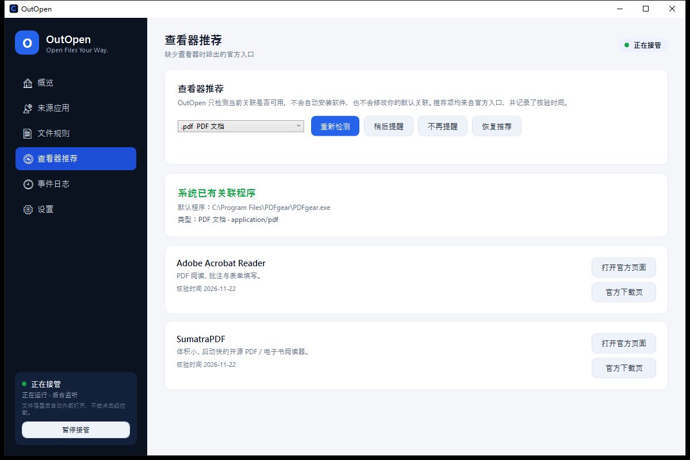
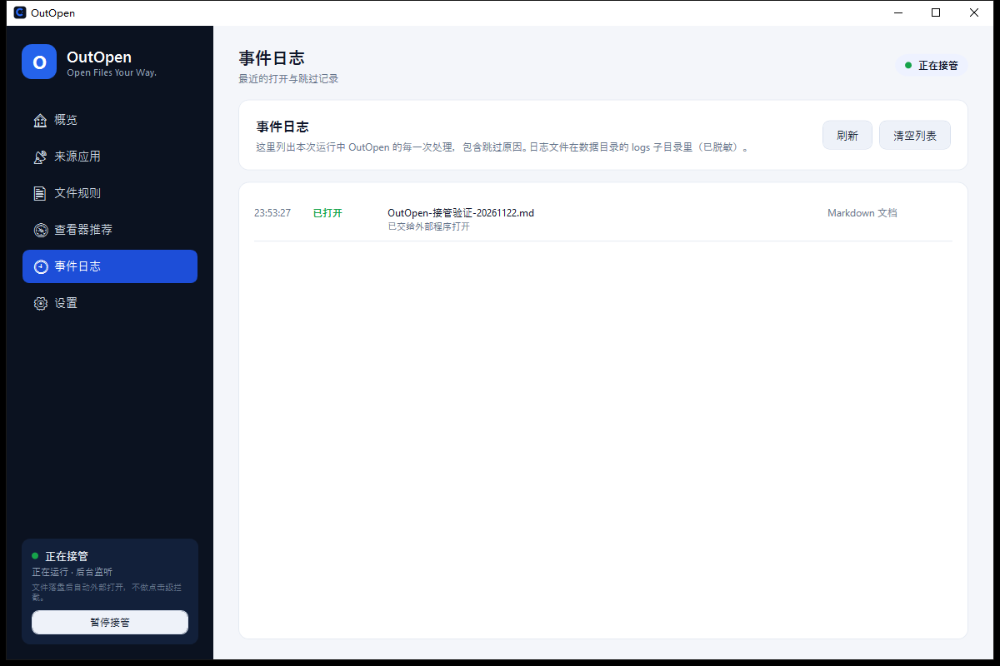
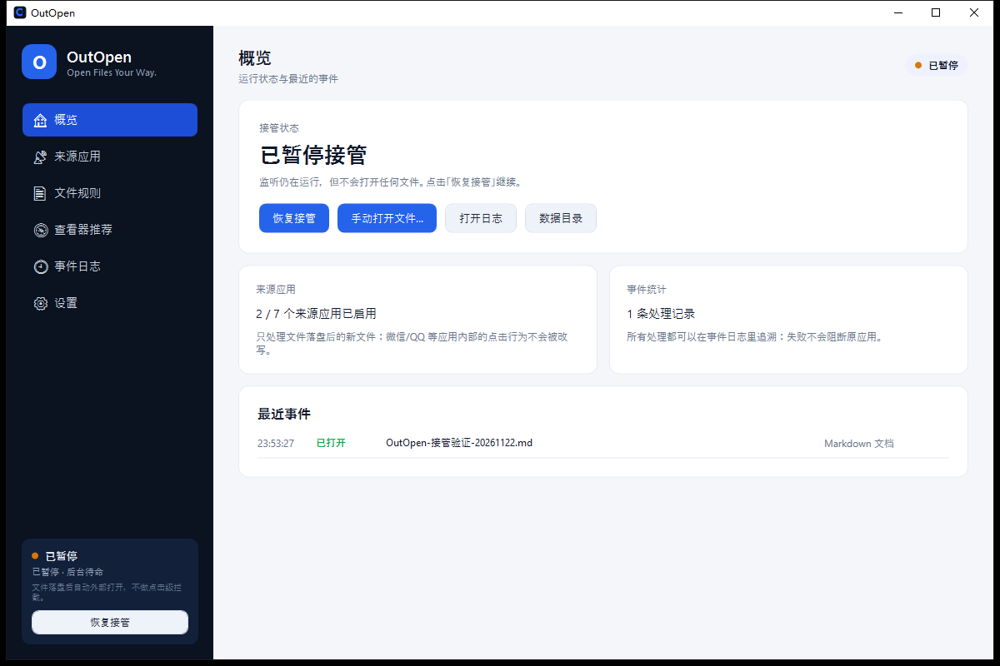
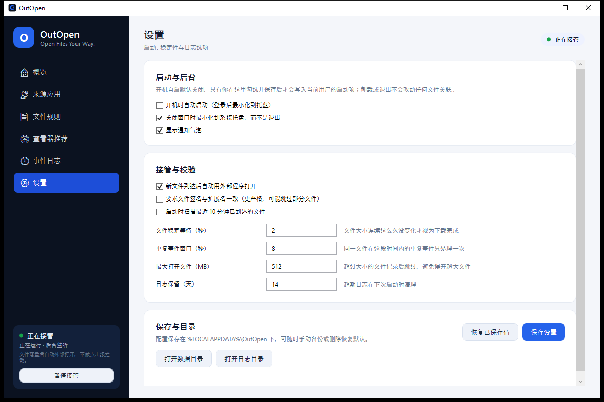
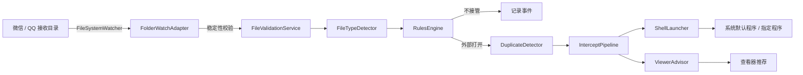

<div align="center">


# OutOpen

**Open Files Your Way.**

微信、QQ 收到的文件，落盘后用你喜欢的程序打开。

[](https://github.com/T1gerD/OutOpen/actions/workflows/ci.yml)
[](https://github.com/T1gerD/OutOpen/releases)
[](LICENSE)
[](docs/COMPATIBILITY.md)
[](https://dotnet.microsoft.com)

[安装包](https://github.com/T1gerD/OutOpen/releases) · [快速开始](#快速开始) · [功能](#功能) · [架构](docs/ARCHITECTURE.md) · [验证记录](docs/VERIFICATION.md) · [兼容性](docs/COMPATIBILITY.md)

</div>


---

## 它解决什么问题

在微信或 QQ 里点开一份 PDF、Word 或 Markdown，内置预览往往只能看：不能舒服地编辑、批注、对比，也不能直接复制到自己的工作流里。OutOpen 不修改微信 / QQ 本体，也不注入它们的进程，而是：

1. 监听你在 OutOpen 里启用的应用**接收文件的本地目录**；
2. 等文件大小稳定（默认 2 秒）后才认为是「下载完成」，跳过 `.part`、`.crdownload`、`~$` 等临时文件；
3. 按扩展名识别类型、校验文件签名、去重、套用你的打开规则；
4. 调用 Windows Shell 把文件交给**系统默认程序**，或你指定的程序；
5. 全程写本地日志（路径脱敏），失败时只记录、不阻断原应用。

> Windows 没有通用的官方接口去拦截第三方应用内部的「点击预览」。OutOpen 采用的是**文件夹监听 + 落盘后外部打开**：它对「收到的文件」有效，但**不会**改变你在微信里点击文件时的预览行为。产品文案和 UI 都按这个事实陈述。

## 功能

| | 功能 | 说明 |
| --- | --- | --- |
| 📂 | 来源应用接管 | 微信 PC、QQ NT 默认启用；钉钉、百度网盘、阿里云盘、OneDrive、Telegram 可按需启用或补充监听目录 |
| 🔍 | 文件识别与校验 | 17 种扩展名 + MIME + 魔数签名；空文件、临时后缀、被占用、超大文件、签名不符都会被拦下 |
| 🧹 | 重复事件去重 | 同一文件在时间窗口内只处理一次（默认 8 秒） |
| ⚙️ | 打开规则 | 每种扩展名可设「外部默认程序 / 指定程序 / 不接管」，可加来源应用限定规则 |
| 🧭 | 查看器推荐 | 检测「没有关联 / 关联失效 / 商店应用」并给出官方下载入口；不自动下载、不静默安装、不改默认关联 |
| 🛡️ | 失败安全回退 | 指定程序不可用时自动回退系统默认程序；打开失败只记录，不影响原应用 |
| 🧺 | 后台与托盘 | 关闭窗口最小化到托盘、暂停/恢复接管、开机自启动（默认关闭，用户勾选才写注册表） |
| 🧾 | 事件与日志 | 界面内事件列表 + `%LOCALAPPDATA%\OutOpen\logs` 按天日志，敏感路径脱敏 |
| ⌨️ | 命令行诊断 | `outopen status / sources / types / check <file> / viewers <ext> / open <file> / autostart` |

## 截图

<table>
  <tr>
    <td width="50%"></td>
    <td width="50%"></td>
  </tr>
  <tr>
    <td><b>来源应用</b>：每个应用一张卡，显示监听目录与接管状态</td>
    <td><b>文件规则</b>：按类型决定打开方式，也可指定程序</td>
  </tr>
  <tr>
    <td width="50%"></td>
    <td width="50%"></td>
  </tr>
  <tr>
    <td><b>查看器推荐</b>：缺查看器时给官方入口，并记录核验时间</td>
    <td><b>事件日志</b>：每次打开/跳过都有原因</td>
  </tr>
  <tr>
    <td width="50%"></td>
    <td width="50%"></td>
  </tr>
  <tr>
    <td><b>暂停接管</b>：暂停期间只记录、不打开</td>
    <td><b>设置</b>：稳定性、去重、大小、日志保留与自启动</td>
  </tr>
</table>

## 快速开始

### 方式一：安装包（推荐）

1. 打开 [Releases](https://github.com/T1gerD/OutOpen/releases) 下载 `OutOpen-0.1.1-setup.exe`；
2. 按安装向导完成安装，在「附加选项」页选择是否**创建桌面快捷方式**、是否**开机自动启动（静默运行在系统托盘）**；
3. 启动 OutOpen，在「来源应用」里确认微信 / QQ 的监听目录，点「保存并应用」；
4. 在微信里接收一个文件，落盘稳定后它会用系统默认程序打开，事件页会留下记录。

安装向导（Inno Setup，按当前用户安装，不需要管理员权限）：

<table>
  <tr>
    <td width="50%"></td>
    <td width="50%"></td>
  </tr>
  <tr>
    <td>欢迎页：品牌图标与版本</td>
    <td>附加选项：桌面快捷方式 / 开机自启动（静默）</td>
  </tr>
  <tr>
    <td width="50%"></td>
    <td width="50%"></td>
  </tr>
  <tr>
    <td>MIT 许可协议</td>
    <td>完成页：可直接启动</td>
  </tr>
</table>

> 卸载会删除程序、开始菜单与桌面快捷方式，并清理开机自启动项；**保留** `%LOCALAPPDATA%\OutOpen` 下的配置、日志和查看器推荐库。

### 方式二：源码构建

```powershell
git clone https://github.com/T1gerD/OutOpen.git
cd OutOpen
dotnet restore
dotnet build -c Release
dotnet test
dotnet run --project src/OutOpen.App          # 启动界面
dotnet run --project src/OutOpen.Cli -- status # 命令行诊断
```

要求：Windows 10 1809+ / Windows 11，[.NET 10 SDK](https://dotnet.microsoft.com/download)（运行安装包只需要 .NET 10 Desktop Runtime）。

## 使用

### 来源应用

默认只启用微信 PC 与 QQ NT，其余应用默认关闭（避免误接管整盘同步目录）。每个应用会显示本机解析到的监听目录；目录不存在时标记「未就绪」，可手动补充目录。

> 微信 4.x / QQ 不同版本的缓存布局会变化。OutOpen 会列出内置候选路径，但**以你机器上的实际目录为准**；找不到时在 `%LOCALAPPDATA%\OutOpen\config.json` 的 `sources.<id>.extraFolders` 里补一条即可。

### 打开规则

| 打开方式 | 行为 |
| --- | --- |
| 外部默认程序 | 通过 Windows Shell 调用系统关联程序 |
| 指定程序 | 用你填写的可执行文件打开；启动失败时自动回退默认程序并记录 |
| 不接管 | 只记录事件，不打开 |

### 查看器推荐

当某个扩展名「没有默认程序 / 关联失效 / 只有商店应用」时，OutOpen 会给出官方入口（含核验时间）。**不会**自动下载、不会静默安装、不会修改你的默认关联；你可以「稍后提醒」「不再提醒」或「恢复推荐」。

### 命令行

```text
outopen status            运行状态、目录、来源概况
outopen sources           来源应用与解析出的监听目录
outopen types             支持的类型与默认动作
outopen check <文件>      类型、签名、校验、规则、查看器的完整判断
outopen viewers <扩展名>  当前关联状态与推荐查看器
outopen open <文件>       立即用 OutOpen 的规则打开一个文件
outopen autostart [on|off] 开机自启动开关（写 HKCU Run）
```

## 工作原理



核心组件（`src/OutOpen.Core`）：

| 组件 | 职责 |
| --- | --- |
| `Detection/FileTypeDetector` | 扩展名 + 前 512 字节魔数签名，识别 17 种类型 |
| `Detection/FileValidationService` | 存在性、大小、临时名、占用、稳定性轮询 |
| `Rules/RulesEngine` | 暂停 / 来源 / 扩展名 / 高级规则的决定顺序 |
| `Rules/DuplicateDetector` | 时间窗口内同一路径只处理一次 |
| `Interop/NativeMethods` + `Launching/ShellLauncher` | `ShellExecuteExW` 调默认程序；指定程序用 `ProcessStartInfo` |
| `Launching/DefaultProgramResolver` | `AssocQueryStringW` 检测关联、失效与商店应用 |
| `Viewers/ViewerAdvisor` | 查看器三态判断、推荐库、稍后/忽略/恢复 |
| `Pipeline/InterceptPipeline` | 把上面这些串成一次完整处理，并做失败回退 |
| `Adapters/FolderWatchAdapter` | 监听来源目录，处理创建/重命名与落盘稳定性 |
| `Hosting/OutOpenHost` | 组合根：配置、适配器、事件、结果与日志生命周期 |

配置写入 `%LOCALAPPDATA%\OutOpen\config.json`，查看器推荐库写入 `%LOCALAPPDATA%\OutOpen\viewer-catalog.json`；损坏的配置会被备份为 `config.invalid-*.json` 并回退默认值，配置写入使用临时文件替换。

## 安全与隐私

- **不注入**微信 / QQ / 钉钉等第三方进程，也不修改它们的文件；
- **不修改文件关联**；卸载或退出不会破坏系统关联；
- **不联网**：没有 HTTP 客户端、没有遥测、没有自动更新；
- 唯一主动写入的注册表项是 `HKCU\Software\Microsoft\Windows\CurrentVersion\Run\OutOpen`，且只在你勾选「开机自启动」时写入；
- 日志路径做脱敏（`%USERPROFILE%`、`wxid_*`、长数字串），可在设置里调整保留天数。

## 支持范围

**文件类型（17）**：`.pdf` `.doc` `.docx` `.xls` `.xlsx` `.ppt` `.pptx` `.txt` `.md` `.csv` `.jpg` `.jpeg` `.png` `.gif` `.zip` `.7z` `.rar`

**来源应用（本机实测状态）**：

| 应用 | 自动识别 | 状态 |
| --- | --- | --- |
| 微信 PC（3.x / 4.x 候选路径） | ✅ 默认启用 | 本机已验证：文件落盘后外部打开 |
| QQ NT | ✅ 默认启用 | 已解析目录；端到端未逐项回归 |
| 钉钉 / 百度网盘 / 阿里云盘 / OneDrive | ⚠️ 需手动确认目录 | 目录布局随版本变化，默认关闭 |
| Telegram | ❌ 不支持自动识别 | 需手动指定目录 |

## 常见问题

<details>
<summary><b>为什么我点了微信里的文件，还是在微信里预览？</b></summary>

因为 OutOpen 不做 DLL 注入，也不 Hook 微信的点击事件（Windows 没有通用的官方接口做这件事）。它监听的是**接收文件目录**：文件完整落盘后自动用外部程序打开。点击级接管属于后续路线图，需要逐个应用验证。
</details>

<details>
<summary><b>会不会把我正在下载的文件打开？</b></summary>

默认要求文件大小连续稳定 2 秒才处理，并跳过 `.part` / `.crdownload` / `~$` 等临时文件、0 字节文件、被其他进程独占的文件。稳定性时间和最大文件大小都可以在设置里调整。
</details>

<details>
<summary><b>我的文件很大，会不会卡住？</b></summary>

超过「最大打开文件」阈值（默认 512 MB）的文件只记录、不打开。校验只读文件头和几次 `FileInfo` 快照，不会把整个文件读进内存。
</details>

<details>
<summary><b>卸载会删除我的配置吗？</b></summary>

不会。卸载只删除程序目录、快捷方式和自启动项，`%LOCALAPPDATA%\OutOpen` 保留。想彻底清理时手动删除该目录即可。
</details>

<details>
<summary><b>为什么安装向导没有「为所有用户安装」？</b></summary>

OutOpen 按当前用户安装（`%LOCALAPPDATA%\Programs\OutOpen`），不需要管理员权限，也不污染系统级目录；自启动同样只写当前用户的 `HKCU`。
</details>

## 路线图

- [x] Shell 外部打开、文件识别校验、规则引擎
- [x] 微信 / QQ 目录监听、稳定性与去重
- [x] 查看器推荐（含 .md → MaxInk 官方入口）
- [x] 托盘、暂停/恢复、日志、开机自启动
- [x] 安装向导（快捷方式 / 静默自启动选项）
- [ ] 更多来源应用的目录探测与验证
- [ ] 点击级接管的应用级适配（需逐应用验证，不做通用注入）
- [ ] 自动更新与安装包签名

## 开发

```powershell
dotnet build OutOpen.sln -c Release         # 全量构建
dotnet test OutOpen.sln                     # 76 个单元测试
dotnet publish src/OutOpen.App -c Release -r win-x64 --self-contained false -o publish/app
dotnet publish src/OutOpen.Cli -c Release -r win-x64 --self-contained false -o publish/cli
iscc installer/OutOpen.iss                  # 生成 dist/OutOpen-0.1.1-setup.exe（Inno Setup 6）
```

仓库结构：

```text
src/OutOpen.Core/     核心引擎（检测、校验、规则、启动、查看器、适配器、宿主）
src/OutOpen.App/      WPF 界面 + 托盘 + 单实例
src/OutOpen.Cli/      命令行诊断工具
tests/                 xUnit 单元测试
installer/            Inno Setup 安装脚本（含简体中文语言文件）
docs/                 架构、验证记录、兼容性、截图
assets/               图标与安装向导图
```

更多细节见 [架构说明](docs/ARCHITECTURE.md)、[验证记录](docs/VERIFICATION.md) 与 [兼容性说明](docs/COMPATIBILITY.md)。

## 贡献

欢迎提 Issue 和 PR。改动前请先看 `docs/ARCHITECTURE.md` 的边界约定：权限判断在 Core、失败必须回退、不得注入第三方进程、不得修改文件关联。提交前请确保 `dotnet build` 与 `dotnet test` 全绿。

## 许可证

[MIT](LICENSE) © 2026 T1gerD

<div align="center">
  <sub>OutOpen is not affiliated with Tencent, DingTalk, Baidu, Alibaba, Microsoft or Telegram.</sub>
</div>
