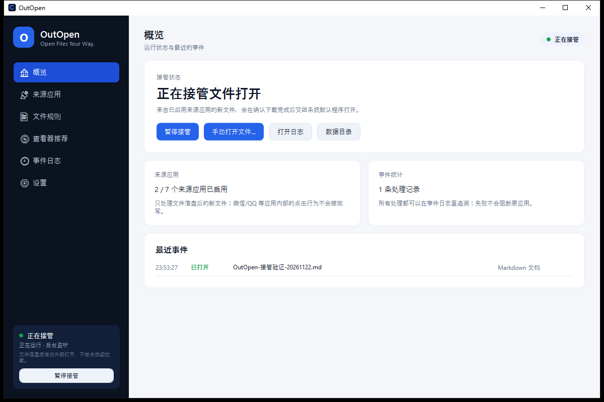

# OutOpen

**Open Files Your Way.**

OutOpen 是一个 Windows 10/11 桌面工具：当微信、QQ 等应用把文件保存到本机之后，OutOpen 会在文件「下载完成」的瞬间，用你选定的查看器打开它，而不是把你锁在应用内置的预览窗口里。

它不是文件关联管理器，也不修改任何应用的安装目录。默认规则是「文档和文本用系统默认程序打开，图片和压缩包不接管」，所有规则都在界面里可改、可随时暂停。



## 它解决什么问题

在微信/QQ 里点开一份 PDF 或 Markdown，内置预览往往只能看、不能舒服地编辑、批注、对比或复制。OutOpen 的做法是：

1. 监听这些应用接收文件的本地目录；
2. 等文件大小稳定（默认 2 秒）后才认为是「下载完成」，跳过 `.part` / `.crdownload` / `~$` 等临时文件；
3. 按扩展名识别类型、校验文件签名、去重、套用你的打开规则；
4. 调用 Windows Shell 把文件交给「系统默认程序」或你指定的程序；
5. 全程写本地日志（路径脱敏），失败时只记录、不阻断原应用。

## 功能

- **来源应用接管**：微信 PC 版、QQ（NT）、钉钉、百度网盘、阿里云盘、OneDrive、Telegram，逐个开关，并显示本机实际监听目录。
- **文件类型规则**：17 种常见类型，逐个设置「用系统默认程序打开 / 用指定程序打开 / 不接管」，也可以先关闭类型、之后随时打开。
- **文件识别与完整性校验**：扩展名 + MIME + 文件头签名（PDF/ZIP/OOXML/OLE/RAR/7Z/JPEG/PNG/GIF），可开启「签名必须与扩展名一致」的严格模式。
- **不打开没下完的文件**：稳定性等待 + 临时文件识别 + 占用检测 + 0 字节/超大文件保护。
- **重复事件合并**：同一文件在窗口期（默认 8 秒）内只处理一次，避免应用重复写盘导致反复弹窗。
- **查看器推荐**：检测「没有关联 / 关联程序不存在 / 商店应用」等状态，给出官方下载入口（含 Markdown 的 MaxInk 推荐），支持稍后提醒、不再提醒、重新检测。**不自动下载、不静默安装、不修改默认关联。**
- **后台运行**：系统托盘、暂停/恢复接管、开机自启（默认关闭，需你手动勾选并保存）、按天日志与保留天数。
- **失败回退**：指定程序打不开时自动回退到系统默认程序；两者都失败时只记录失败，不阻断原应用。
- **单实例**：重复启动会提示并激活已运行实例；关闭窗口默认最小化到托盘。`OutOpen.exe --quit` 可让已运行的实例正常退出（卸载脚本同样使用这个参数）。

## 快速开始

### 环境

- Windows 10 1809+ / Windows 11
- [.NET 10 SDK](https://dotnet.microsoft.com/download)（构建与运行桌面应用）

### 构建与运行

```bash
git clone https://github.com/T1gerD/OutOpen.git
cd OutOpen

dotnet build OutOpen.sln
dotnet test OutOpen.sln

# 启动桌面应用（默认最小化到托盘，可用 --tray 参数直接隐藏窗口）
dotnet run --project src/OutOpen.App

# 诊断 CLI
dotnet run --project src/OutOpen.Cli -- status
dotnet run --project src/OutOpen.Cli -- sources
dotnet run --project src/OutOpen.Cli -- types
dotnet run --project src/OutOpen.Cli -- check "C:\path\to\报告.pdf"
dotnet run --project src/OutOpen.Cli -- viewers .md
dotnet run --project src/OutOpen.Cli -- autostart status
```

### 数据与日志位置

| 内容 | 路径 |
| --- | --- |
| 配置 | `%LOCALAPPDATA%\OutOpen\config.json` |
| 查看器推荐库 | `%LOCALAPPDATA%\OutOpen\viewer-catalog.json` |
| 日志 | `%LOCALAPPDATA%\OutOpen\logs\outopen-YYYYMMDD.log` |
| 开机自启 | `HKCU\Software\Microsoft\Windows\CurrentVersion\Run` 的 `OutOpen` 值 |

配置文件损坏时会自动备份为 `config.invalid-<时间戳>.json` 并回退默认值；写入采用临时文件替换，避免半截 JSON。

## 界面

| 页面 | 说明 |
| --- | --- |
| 概览 | 接管状态、来源/事件摘要、最近事件、暂停与手动打开 |
| 来源应用 | 逐个启用/停用来源，显示本机实际监听目录 |
| 文件规则 | 每种扩展名的开关、打开方式、指定程序 |
| 查看器推荐 | 关联状态检测、官方下载入口、稍后/不再提醒 |
| 事件日志 | 本次运行的全部处理记录与跳过原因 |
| 设置 | 开机自启、托盘、稳定性等待、去重窗口、大小上限、日志保留 |

更多截图见 [`docs/screenshots/`](docs/screenshots/)。

## 支持范围

支持的扩展名：`.pdf` `.doc` `.docx` `.xls` `.xlsx` `.ppt` `.pptx` `.txt` `.md` `.markdown` `.csv` `.jpg` `.jpeg` `.png` `.gif` `.zip` `.7z` `.rar`。

默认策略：文档/文本/表格/演示「用系统默认程序打开」；图片和压缩包「不接管」（可在文件规则里打开）。

来源应用的默认监听目录与验证状态见 [`docs/COMPATIBILITY.md`](docs/COMPATIBILITY.md)。

## 技术验证（本机实测）

在 Windows 10 19045 + .NET 10 上做过真实端到端验证：

- 向微信接收目录写入一个 `.md` 文件，约 6 秒后 OutOpen 记录「已打开」并把文件交给本机默认 Markdown 查看器（MaxInk）；
- 暂停接管后投放文件不会被打开，恢复后再次投放会重新打开；
- 同名文件在去重窗口内第二次写入被记录为「重复忽略」，不会重复打开。

完整记录（含 13 条验收对照与证据）见 [`docs/VERIFICATION.md`](docs/VERIFICATION.md)。

## 项目结构

```
src/OutOpen.Core/     引擎：识别、校验、规则、去重、启动、查看器、适配器、宿主
src/OutOpen.App/      WPF 界面、托盘、单实例启动
src/OutOpen.Cli/      诊断与演示 CLI（outopen）
tests/                xUnit 单元测试（76 个）
docs/                 架构、验证、兼容性文档与截图
installer/            Inno Setup 安装脚本
assets/               应用图标
```

架构与数据流见 [`docs/ARCHITECTURE.md`](docs/ARCHITECTURE.md)。

## 边界与已知限制

- **不是点击级拦截**：OutOpen 监听的是应用落盘后的文件目录，微信/QQ 内部的「点击预览」不会经过 OutOpen；它接管的是「文件已经到本地之后」的打开行为。仅监听目录，不注入进程、不做全局 Hook、不修改应用本体。
- 应用升级可能改变缓存目录；可在「来源应用」中补充额外监听目录（`config.json` 的 `sources.<id>.extraFolders`）。
- 部分打包应用（Microsoft Store 应用）无法直接取得可执行文件路径，查看器推荐会如实显示「商店应用」而不是猜测。
- 图片与压缩包默认不接管，避免误开截图/表情包和压缩包内文件。
- 安装/卸载不会修改系统文件关联；OutOpen 只读取关联信息。

## 隐私

- 全部逻辑在本机运行，不发起任何网络请求。
- 日志中的用户目录、微信 ID、长数字串会被脱敏（`%USERPROFILE%`、`wxid_***`、`***`）。
- 不收集遥测，不上传文件名。

## 构建安装包

需要 [Inno Setup 6](https://jrsoftware.org/isinfo.php)：

```bash
dotnet publish src/OutOpen.App -c Release -r win-x64 --self-contained false -o publish/app
dotnet publish src/OutOpen.Cli -c Release -r win-x64 --self-contained false -o publish/cli
iscc installer/OutOpen.iss
```

安装包默认按用户安装到 `%LOCALAPPDATA%\Programs\OutOpen`，卸载时保留 `%LOCALAPPDATA%\OutOpen` 下的配置与日志。

## 许可

[MIT](LICENSE)
